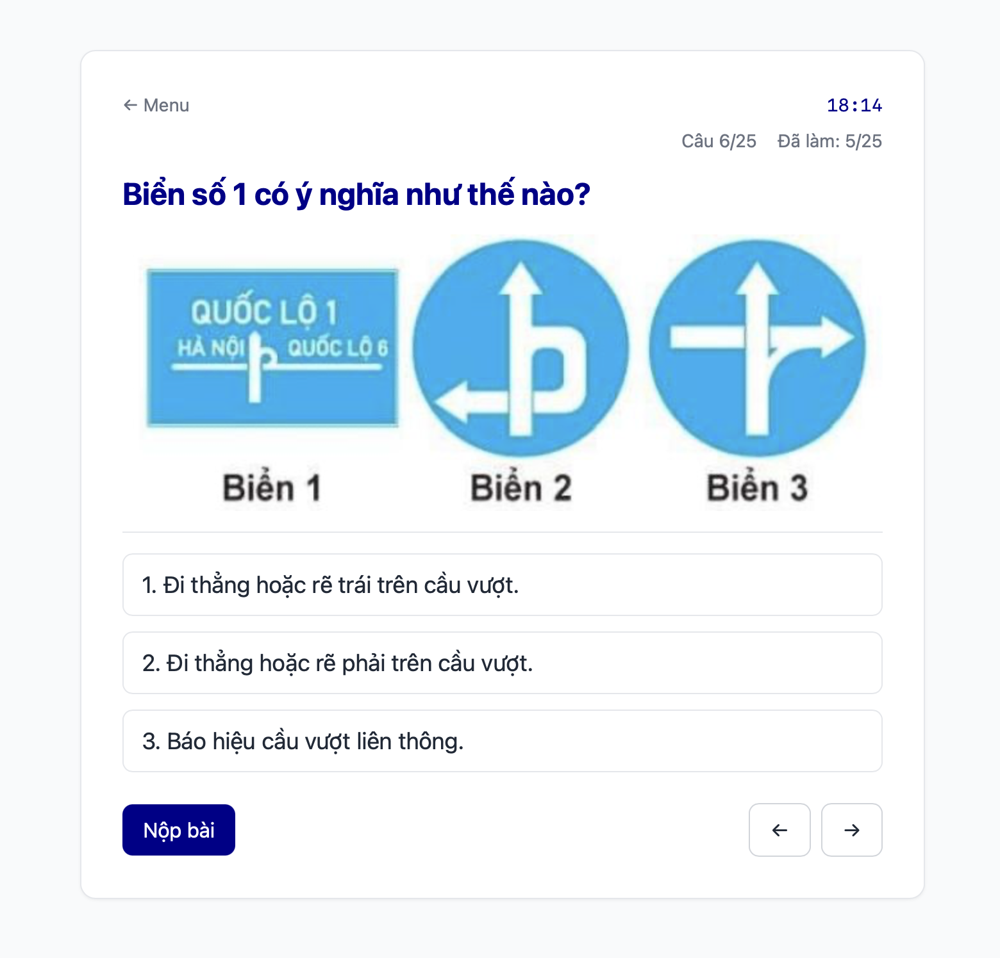

# A/A1 Motorbike License Trainer

A simple static web app for reviewing questions in the theory test for the Vietnamese A and A1 motorbike license. Comes with a "mock test" mode that follows the official composition, pressurizes you with the actual 19-minute timer, and a scary fail screen if you answer one of those *câu liệt* incorrectly. Also comes with a "full" mode that allows you to answer all 250 questions in the set and review how you did.



Questions and test composition were last updated in June 2025.

Available at [https://a-license-trainer.web.app](https://a-license-trainer.web.app).

## Stack

Vanilla JavaScript with TailwindCSS CDN (simple!). The app is then hosted on Firebase.

## Setup

### Run locally

Clone this repo, then run

```bash
npx serve .
```

and enjoy your app at `http://localhost:3000`.

### Deploy to Firebase

0. **Rename** `firebase.json` into something else for now, so that you can initialize a fresh hosting setup for your own Firebase project.
1. On the Firebase console, create a Firebase project, then, add a **Web App** with **Hosting** enabled.
2. Follow Firebase's instructions, including replacing the `firebaseConfig` block in `scripts/firebase.example.js` with your own block of configuration that Firebase just generated for you and installing Firebase CLI on your device.
    - Remember to rename the file into `firebase.js`.
    - Make sure to enable **Hosting** as a service, and not **App Hosting**. That's for full-stack apps!
3. Run
    ```bash
    firebase login
    ```
    and then, after logging in

    ```bash
    firebase init
    ```
4. Follow the initialization process. Choose the option to go with **an existing project**, then choose your newly-created Firebase project.
    - Select **No** when prompted with
        > Configure as a single-page app (rewrite all urls to /index.html)?

        and
        
        > File index.html already exists. Overwrite?
5. Delete the generated `firebase.json` file and rename your file in step 0 into `firebase.json`.
6. Run
   ```bash
    firebase deploy
   ```
   and enjoy your app at `https://<your-project-name>.web.app`.
